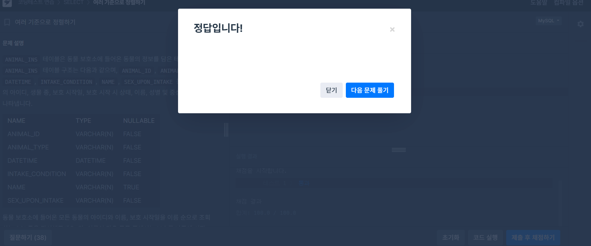
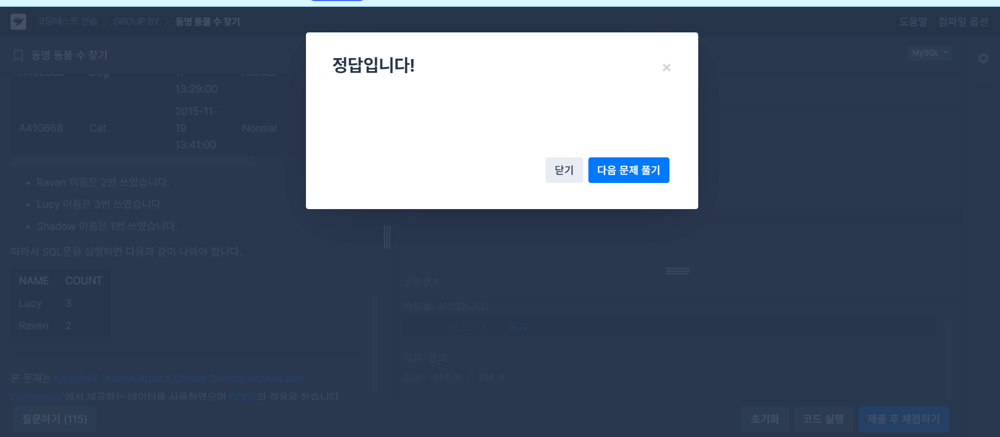

# 📘 SQL_BASIC 7주차 정규 과제

이번 주 필수 강의는 없습니다.

이번 주는 지금까지 배운 SQL 내용을 가볍게 복습하는 것으로 마무리합니다. 문제 풀이보다 중요한 것은 **내가 어떤 SQL 개념을 익혔고, 아직 어떤 부분이 헷갈리는지 정리하는 것**입니다.

완성된 과제는 Github에 업로드하고, 링크를 스프레드시트 'SQL' 시트에 입력해 제출해주세요.

**👀 수행 인증란은 필수입니다.**

---

## 📚 SQL_BASIC_7th_REVIEW

---

## ✨ 선택 강의

- 6-2. 가독성을 챙기기 위한 SQL 스타일 가이드: SQL을 더 읽기 좋게 작성하고 싶을 때 선택 수강
- 6-3. 가독성을 챙기기 위한 WITH 문 & 파티션: WITH 문과 파티션 개념을 가볍게 살펴보고 싶을 때 선택 수강
- 6-4. 데이터 결과 검증 정의: 쿼리 결과를 검증하는 관점을 알고 싶을 때 선택 수강
- 6-5. 데이터 결과 검증 예시: 결과 검증 사례를 확인하고 싶을 때 선택 수강

---

## 🏁 전체 강의 수강 계획

| 주차 | 필수 강의 범위 | 선택 강의 | 완료 여부 |
| --- | --- | --- | --- |
| 1주차 | 1-1 ~ 2-1 | 1 | ✅ |
| 2주차 | 2-2 ~ 2-3 | 2-4 | ✅ |
| 3주차 | 2-5, 2-7 ~ 2-8 | 2-6 | ✅ |
| 4주차 | 3-2 ~ 4-3 | 3-4 | ✅ |
| 5주차 | 4-4 ~ 4-6 | 4-5, 4-7 | ✅ |
| 6주차 | 5-2 ~ 5-5 | 5-6 | ✅ |
| 7주차 | 필수 강의 없음 | 6-2, 6-3, 6-4, 6-5 | ✅ |

---

<br>

<!-- 여기까진 그대로 둬 주세요-->

---

## 🔁 복습할 개념

- SELECT, FROM, WHERE
- ORDER BY, LIMIT
- GROUP BY, HAVING
- COUNT, SUM, AVG, MAX, MIN
- 문자열 함수
- 날짜/시간 함수
- CASE WHEN
- JOIN

---

# 1️⃣ 전체 개념 복습

아래 키워드 중 중요하다고 생각한 개념을 2개 이상 골라 짧게 정리해주세요. 3개보다 더 많이 정리하고 싶다면 자유롭게 항목을 추가해도 좋습니다.

복습 키워드:
- SELECT
- WHERE
- GROUP BY
- HAVING
- 문자열 함수
- 날짜/시간 함수
- CASE WHEN
- JOIN

## 01.

```
개념 이름: 예약어
개념 설명: 커리 파악 기준점. 
예시 쿼리: SELECT, col, FROM table, WHERE
```

## 02.

```
개념 이름: 컬럼 이름은 snake_case로 작성
개념 설명: 회사의 기준에 따라 사용
예시 쿼리: SELCET, col1 AS event_status
```

## (선택) 03.

```
개념 이름: WITH 구문
개념 설명: CTE (Common Table Expression), SELECT구문에 이름을 정해주는 것과 유사
아직 헷갈리는 점:
```

---

# 2️⃣ 수행 인증란

아래 중 하나 이상을 첨부해주세요.

- 
- SQL 실행 결과 화면 캡처
- 전체 개념 정리 노트 캡처

---

# 3️⃣ 복습 문제

프로그래머스는 로그인이 필요하므로, 로그인 후 문제 풀이를 진행해주세요.

## 🧩 문제 1

문제 링크: [여러 기준으로 정렬하기](https://school.programmers.co.kr/learn/courses/30/lessons/59404)

풀이 과정:

```
- 문제 요구사항: 모든 동물의 아이디, 이름, 보호 시작일을 조회
- 첫 번째 정렬 기준: 이름을 기준으로 오름차순 정렬
- 두 번째 정렬 기준: 이름이 같으면 보호 시작일을 기준으로 내림차순 정렬
- 복습한 점: ORDER BY에 여러 컬럼을 쉼표로 구분하여 정렬 우선순위를 지정할 수 있음
```

<>

## 🧩 문제 2

문제 링크: [동명 동물 수 찾기](https://school.programmers.co.kr/learn/courses/30/lessons/59041)

풀이 과정:

```
- 그룹화 기준: 동물의 이름(NAME)
- 제외해야 하는 값: 이름이 없는 동물(NULL)
- HAVING 조건:  같은 이름이 두 번 이상 사용된 경우(COUNT(*) >= 2)
- 복습한 점:  WHERE는 그룹화 전에 데이터를 제외하고, HAVING은 GROUP BY로 집계한 결과에 조건을 적용함
```

<>

---

# 4️⃣ 최종 회고

7주 동안 SQL BASIC 과제를 진행하며 느낀 점을 자유롭게 작성해주세요.

```
1. SQL을 배우기 전과 비교했을 때 달라진 점: 문제에서 요구하는 컬럼과 조건을 파악하고 SELECT, FROM, WHERE, GROUP BY, HAVING, ORDER BY 순서로 쿼리를 작성할 수 있게 되었습니다.
2. 가장 도움이 되었던 과제 또는 문제 유형: 프로그래머스 문제를 직접 풀고 실행 결과를 확인하는 과제가 가장 도움이 되었습니다. 특히 날짜 조건, 집계 함수, CASE WHEN을 활용하는 문제를 통해 실전 작성 방법을 익힐 수 있었습니다.
3. 가장 어려웠던 개념:  WHERE와 HAVING의 차이, 날짜 형식 변환, 여러 조건을 결합하는 부분이 어려웠습니다. 반복해서 문제를 풀면서 WHERE는 집계 전 조건, HAVING은 집계 후 조건에 사용한다는 점을 이해하게 되었습니다.
4. 앞으로 데이터 분석이나 프로젝트에서 SQL을 어떻게 활용해보고 싶은지: : 필요한 데이터를 조건에 맞게 추출하고 그룹별 특징이나 기간별 변화를 분석하는 데 활용하고 싶습니다. 이후 Python과 연결하여 SQL로 데이터를 추출하고 시각화와 통계 분석까지 진행해보고 싶습니다.
5. SQL BASIC 과제에 대한 피드백: 강의에서 배운 내용을 문제 풀이로 바로 복습할 수 있어 유익했습니다.
```

정말 수고하셨습니다!


